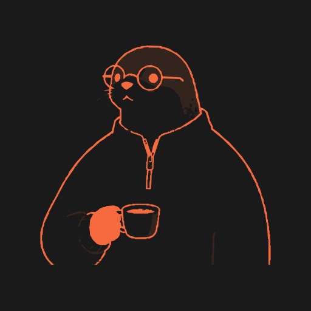
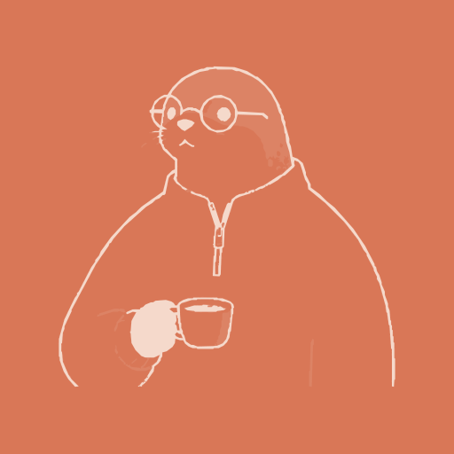
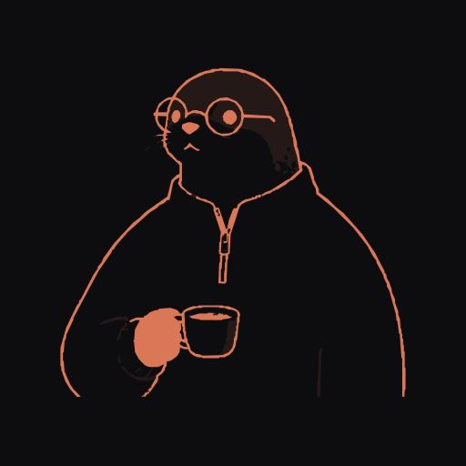
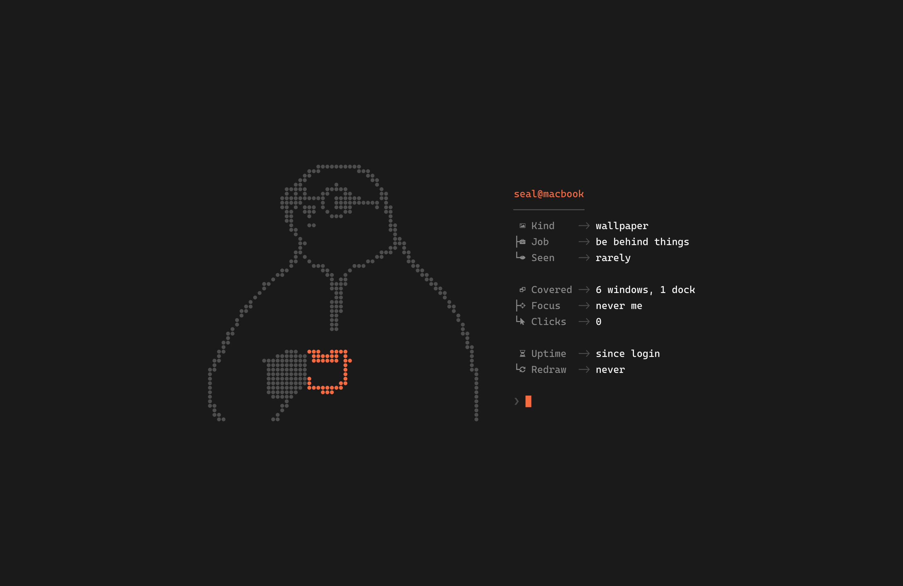
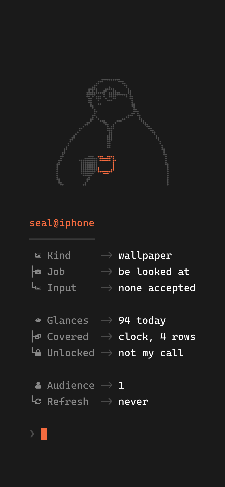
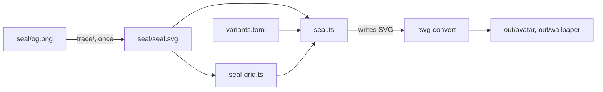

<div align="center">



### `THE SEAL // ONE DRAWING, EVERYTHING DERIVED FROM IT`

*a mascot, its colour variants, and two wallpapers that report on their own working conditions*

    

</div>

---

## 🧭 What is this

The seal is a seal in glasses holding coffee. It is the GitHub avatar, the fastfetch logo, the mark at the bottom of every pitch page, and the face automations wear on Discord. Before this repo each of those held its own copy of the drawing and its own idea of the colours. Now there is one illustration, one traced line-art version of it, and a colour table, and everything else is rendered from those.

The palette that started it is `#1a1a1a` background and `#f56b3f` accent, borrowed from a year-progress wallpaper. The type is Cascadia Code NF, because the wallpapers are pretending to be a terminal.

The wallpapers are still here. Each is a status readout about itself: covered by six windows, clicked zero times, never had focus. It reports this without complaint.

```console
nick@sealfetch:~$ bun seal.ts
avatar/sigil
avatar/sigil-dark
avatar/terminal
avatar/mono
wallpaper/mac-4096x2304  fetch + json
wallpaper/mac-3024x1964  fetch + json
wallpaper/iphone-1170x2532  fetch + json
```

## 🎨 The variants

Every variant is the same trace in one colour pair from `variants.toml`. Adding one is one entry.

| | variant | what it actually is |
|---|---|---|
| 01 | **sigil** | cream on terracotta, 512px square. the avatar of SIGIL, the persona automations speak as |
| 02 | **sigil-dark** | terracotta on near-black, for the same job on dark surfaces |
| 03 | **terminal** | orange on `#1a1a1a`, the seal in the wallpaper palette |
| 04 | **mono** | the bare trace, transparent, `currentColor`. paste it inline and it takes the page's text colour |
| 05 | **og** | the 2048px illustration itself, in `seal/`. not rendered, it is the source |

<div align="center">

  

</div>

## 📸 The wallpapers

Two designs saying the same thing in different clothes. Both stay.

| | design | what it actually renders |
|---|---|---|
| 01 | **fetch** | neofetch layout: seal on the left as a dot grid, `key -> value` on the right. accent on the hostname, the mug, and the cursor |
| 02 | **json** | the same facts as `wallpaper.json` open in an editor, line-number gutter included. the entire seal is the `"avatar"` array. the last row drops its trailing comma, because it is pretending to be a real file |

<details>
<summary>six files, three sizes, two designs</summary>


*fetch, 3024x1964, the built-in display*


*json, same facts, worse posture*


*fetch, 1170x2532, the phone gets 40 columns instead of 48*

</details>

## 🚀 Run it

Needs [Bun](https://bun.sh), `rsvg-convert` (`brew install librsvg`), and Cascadia Code NF installed as a system font. The font is not optional: every horizontal measurement in the wallpapers derives from its advance width.

```bash
git clone https://github.com/nitrimandylis/sealfetch.git
cd sealfetch
bun seal.ts
```

Four avatars and six wallpapers land in `out/`, overwriting the ones committed here. `bun seal.ts --check` runs the self-check and renders nothing. You do not need to run anything to use the assets: `out/` is committed, and `out/avatar/` is meant to be hotlinked.

## 🔩 Under the hood



| file | job |
|---|---|
| `seal/og.png` | the illustration. the source of truth for the seal itself |
| `seal/seal.svg` | the trace, `currentColor`, frozen. every rendered asset is this at a colour |
| `seal/avatar-460.png` | the 460px download the trace was made from, kept so the trace is reproducible |
| `trace/` | the tracing pipeline, borrowed from the pitch repo. for future designs, not re-run on this one |
| `variants.toml` | the colour table |
| `seal.ts` | avatar renderer, wallpaper layout, type metrics, the self-check |
| `seal-grid.ts` | the seal as a 60x57 dot grid plus two half-block text grids, baked from the trace |
| `out/` | everything rendered, committed |

The trace is deliberately not regenerated from the 2048px original, even though that gives a sharper mark. The one that exists already ships in three other places and the decision was to keep them in agreement rather than chase whiskers.

**Stack:** Bun · TypeScript · SVG · librsvg · a little Python for the trace

---

<div align="center">

**[Nick Trimandylis](https://github.com/nitrimandylis)**

`IT HAS NEVER HAD FOCUS AND IT IS FINE`

MIT licensed, the drawing included.

</div>
