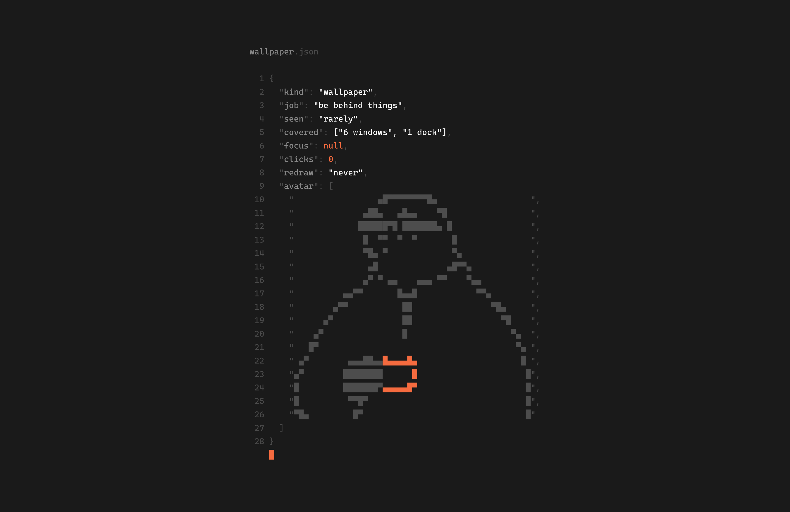
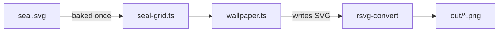

```
 ███████╗███████╗ █████╗ ██╗     ███████╗███████╗████████╗ ██████╗██╗  ██╗
 ██╔════╝██╔════╝██╔══██╗██║     ██╔════╝██╔════╝╚══██╔══╝██╔════╝██║  ██║
 ███████╗█████╗  ███████║██║     █████╗  █████╗     ██║   ██║     ███████║
 ╚════██║██╔══╝  ██╔══██║██║     ██╔══╝  ██╔══╝     ██║   ██║     ██╔══██║
 ███████║███████╗██║  ██║███████╗██║     ███████╗   ██║   ╚██████╗██║  ██║
 ╚══════╝╚══════╝╚═╝  ╚═╝╚══════╝╚═╝     ╚══════╝   ╚═╝    ╚═════╝╚═╝  ╚═╝
```

<div align="center">

### `NEOFETCH // BUT IT IS A SEAL // AND IT IS A WALLPAPER`

*matching Mac and iPhone wallpapers that report on their own working conditions*

    

</div>

---

## 🦭 What is this

A script that renders wallpapers for a Mac and an iPhone from one seal drawing, so both screens look like the same machine. The palette is `#1a1a1a` background, `#f56b3f` accent, and the type is Cascadia Code NF, because the wallpaper is pretending to be a terminal.

The gag is that each wallpaper is a status readout about itself. It is covered by six windows, it has been clicked zero times, and it has never had focus. It reports this without complaint.

There is no image editor in the pipeline. The script writes SVG text and hands it to `rsvg-convert`.

```console
nick@sealfetch:~$ bun wallpaper.ts
[✓] out/fetch-mac-4096x2304.png
[✓] out/json-iphone-1170x2532.png
[i] 6 files. the seal has been informed.
```

## 🎨 The two variants

Both say the same thing in different clothes. They were built to compete and neither has been fired.

| | variant | what it actually renders |
|---|---|---|
| 01 | **fetch** | neofetch layout — seal on the left as a dot grid, `key → value` on the right. accent on the hostname, the mug, and the cursor |
| 02 | **json** | the same facts as `wallpaper.json` open in an editor, line-number gutter included. the entire seal is the `"avatar"` array. the last row drops its trailing comma, because it is pretending to be a real file |

## 📸 Evidence

<details>
<summary>six files, three sizes, two variants</summary>


*fetch — 3024x1964, the built-in display*


*json — same facts, worse posture*


*fetch — 1170x2532, phone gets 40 columns instead of 48*

</details>

## 🚀 Run it

Needs [Bun](https://bun.sh), `rsvg-convert` (`brew install librsvg`), and Cascadia Code NF installed as a system font. The last one is not optional — every horizontal measurement in the script derives from that font's advance width.

```bash
git clone https://github.com/nitrimandylis/sealfetch.git
cd sealfetch
bun wallpaper.ts
```

Six PNGs land in `out/`, overwriting the ones committed here. `bun wallpaper.ts --check` runs the self-check and renders nothing.

## 🔩 Under the hood



| file | job |
|---|---|
| `wallpaper.ts` | layout, type metrics, both renderers, the self-check |
| `seal-grid.ts` | the seal as a 60x57 dot grid plus two half-block text grids. baked, not rasterised at run time — the drawing never changes |
| `seal.svg` | the source drawing. kept so the grids can be regenerated |
| `out/` | six PNGs, committed so you can use them without a font install |

Three grids exist because a character cell is 0.586 wide and 1.6 tall, so the dot grid rendered as text comes out about 2.7x stretched and only the head fits. The text variants are rasterised at the cell's real aspect and encoded with `▀▄█`, which buys back the vertical resolution.

**Stack:** Bun · TypeScript · SVG · librsvg

---

<div align="center">

**[Nick Trimandylis](https://github.com/nitrimandylis)**

`IT HAS NEVER HAD FOCUS AND IT IS FINE`

MIT licensed.

</div>
